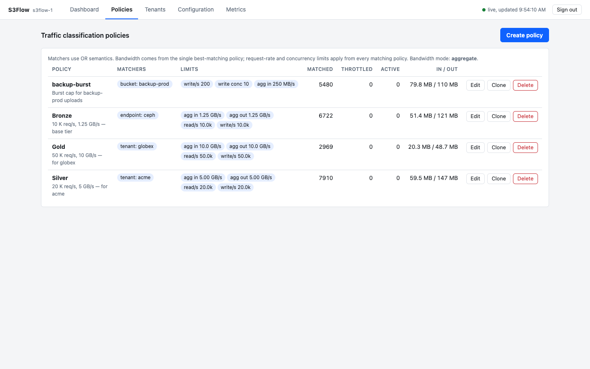
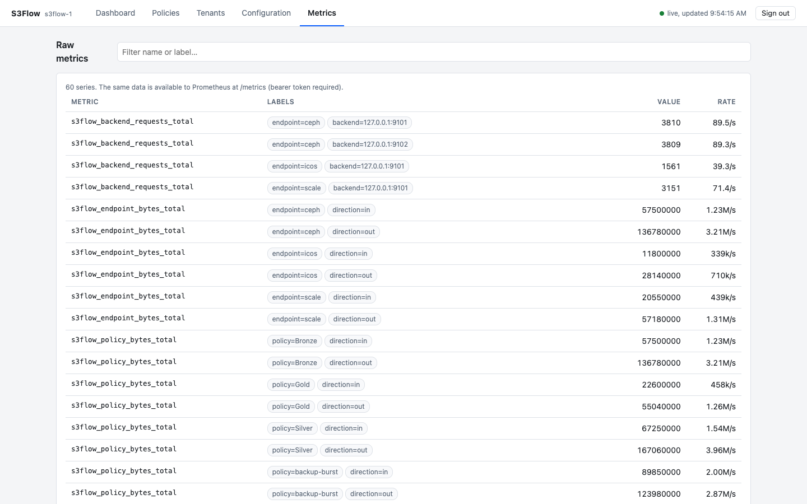

# S3Flow

**Policy-driven S3 traffic control for IBM object storage**

S3Flow is a transparent S3 front-end proxy with QoS. A single static Go binary
(standard library only), `s3flow`, sits in front of
**IBM Storage Ceph (RGW)**, **Storage Scale CES S3** and **IBM Cloud Object
Storage (ICOS)** and applies traffic-classification policies (bandwidth,
request-rate and concurrency limits) to S3 traffic.

It is a *transparent reverse proxy*, not a gateway: requests and responses are
streamed. The request line, `Host`, signed headers and body are never altered,
so SigV4/SigV2 verification, bucket authorisation and S3 semantics stay with
the backend. This is covered by a test (`TestSignedRequestPassesThroughUnmodified`)
that runs a backend performing real SigV4 verification behind the proxy.

## Feature mapping

| Capability | S3Flow |
|---|---|
| Matchers `bucket`, `bucket-regex`, `tenant`, `cidr` (IPv4), `endpoint`, `inverse` | same names/JSON; OR semantics; regex unanchored |
| Best-match bandwidth precedence (/32 IP, bucket, regex, tenant, endpoint, CIDR, inverse) | implemented; bandwidth taken from the single winning policy only |
| `aggregateBandwidthIn/Out` | shared limiter per policy |
| `perRequestBandwidthIn/Out` | independent limiter per request |
| Aggregate and per-request cannot be mixed | enforced via `bandwidthMode` setting (policies violating it are rejected with 422) |
| `read/writeRequestRate` | token bucket; GET/HEAD/LIST = read group, everything else = write group |
| `concurrentRead/WriteRequests` | counting gate; slots rolled back on partial failure |
| Per-operation limits (get, head, list, put, copy, multipart, delete) | optional rate and concurrency limit per operation, layered on the group limits (see below) |
| Over-limit behaviour | 250 ms delay then `503 SlowDown` (S3 XML error) – no queue |
| Request/concurrency limits apply from *any* matching policy | implemented |
| Tenant = access key ID, else bucket owner | `/api/v1/tenants` mapping (access keys and owned buckets); handles SigV4, SigV2 and presigned URLs |
| Management API | `/api/v1/traffic-classes` CRUD (PUT is a full replacement) |
| Observability | Prometheus `/metrics` |
| Multi-node | state replication + optional fleet-wide division (below) |

| Web console | built in at `/ui/` on the admin listener (see below) |

Not provided: any *guarantee* of backend performance – these are ceilings, not
reservations.

## Read/write groups and per-operation limits

Every request is classified into one S3 operation from its method, path, query
string and `x-amz-copy-source` header (the signed request is not touched):

| Operation | Group | Requests |
|---|---|---|
| `get` | read | GetObject, bucket/object sub-resource reads (`?acl`, `?tagging`, `?versioning`, ...) |
| `head` | read | HeadObject, HeadBucket |
| `list` | read | ListBuckets, ListObjects/ListObjectsV2, ListObjectVersions, ListMultipartUploads, ListParts |
| `put` | write | PutObject, CreateBucket, sub-resource writes, POST uploads |
| `copy` | write | CopyObject |
| `multipart` | write | Initiate, UploadPart(Copy), Complete, Abort |
| `delete` | write | DeleteObject, DeleteObjects (`POST ?delete`), DeleteBucket |
| `other` | write | any other method |

Two kinds of limit can be combined in the same policy:

* **Group limits** – `readRequestRate`, `writeRequestRate`,
  `concurrentReadRequests`, `concurrentWriteRequests` cap the whole group.
* **Operation limits** – `<op>RequestRate` and `concurrent<Op>Requests`
  (`getRequestRate`, `concurrentListRequests`, `deleteRequestRate`,
  `concurrentMultipartRequests`, ...) cap a single operation.

A request must satisfy **both** its group limit and its own operation limit
(and the limits of every matching policy). Operations without an operation
limit are governed by the group limit alone, so you can limit a group as a whole
and fine-tune only some operations, or leave a group unlimited and limit just
one operation:

```json
{ "name": "tame-listing-and-deletes",
  "matchers": [{"type": "tenant", "members": ["acme"]}],
  "limits": [
    {"type": "writeRequestRate",   "value": 500},
    {"type": "deleteRequestRate",  "value": 50},
    {"type": "listRequestRate",    "value": 20},
    {"type": "concurrentListRequests", "value": 4}] }
```

Here reads other than LIST are unlimited, writes share 500 req/s, and deletes
are additionally held to 50 req/s within that. A request rejected by an
operation limit does not consume group tokens or concurrency slots. Rejections
report the limit that fired in the `limit` label of
`s3flow_policy_throttled_total`.

Bandwidth limits are not per operation: they follow the direction of the data
(upload = in, download = out) and use the best-match policy as before.

## Default Gold, Silver and Bronze tiers

The first time a node starts with an empty state it creates three ordinary
policies, so the common service levels exist from day one:

| Tier | Read requests/s | Write requests/s | Upload | Download |
|---|---|---|---|---|
| Gold | 50 000 | 50 000 | 10 GB/s (80 Gbps) | 10 GB/s |
| Silver | 20 000 | 20 000 | 5 GB/s (40 Gbps) | 5 GB/s |
| Bronze | 10 000 | 10 000 | 1.25 GB/s (10 Gbps) | 1.25 GB/s |

* The request rate is applied to reads and to writes separately, so each tier
  allows up to twice its figure in total if the load is evenly mixed. To hold a
  tier to its figure as a combined total, halve both values in the console.
* Bandwidth is shown in decimal gigabytes (1 GB/s = 1 000 000 000 bytes/s).
* The tiers have **no matchers**, so they match nothing and change no traffic
  until you attach them. Open **Policies**, edit a tier and add an `endpoint`,
  `tenant`, `bucket` or `cidr` matcher (for example `tenant: acme`).
* They are normal policies. Every limit can be changed in the console or API:
  bandwidth, the read and write group rates and concurrency, and all
  per-operation limits. You can rename, clone or delete them.
* They are created once. After you delete or change them they are never
  re-created, and a node that joins an existing cluster takes the cluster's
  policies instead of adding its own.
* A tenant can only follow one bandwidth tier at a time: for bandwidth the most
  specific matching policy wins, while request-rate and concurrency limits of
  every matching policy all apply.

The screenshot below shows four policies in the console — Bronze attached to
the `ceph` endpoint, Gold and Silver attached to specific tenants, and a
`backup-burst` bucket policy — with live matched-request counts and byte
throughput after a few minutes of mixed load:



## Build / run

```sh
make test build
export S3FLOW_ADMIN_TOKEN=$(openssl rand -hex 24)
export S3FLOW_CLUSTER_TOKEN=$(openssl rand -hex 24)
./bin/s3flow -config config.example.json
```

Endpoint names are what the `endpoint` matcher refers to. Use one endpoint per
backend system (Ceph / Scale / ICOS) and/or per client-facing VIP.

### Load balancing across IP addresses and ports

An `endpoint` accepts clients on one or more addresses and spreads requests over
a pool of backends. Every listener of an endpoint shares the same policies and
the same backend pool.

| Field | Meaning |
|---|---|
| `listen`, `listeners` | Bind addresses as `host:port`. `listen` is the primary; `listeners` adds more, so one endpoint can serve several IPs and ports (for example `10.1.0.10:443`, `10.1.0.11:443`, `10.1.0.10:8443`). At least one is required; an address may be used only once across all endpoints and the admin listener. TLS settings apply to all of them |
| `backends` | Targets as `scheme://host:port`. The same IP on different ports counts as separate targets. Duplicates are rejected |
| `backendWeights` | Relative share per backend, keyed by the exact string in `backends`; default 1 |
| `balance` | `roundrobin` (default, smooth weighted: a 3:1 weighting alternates A A B A rather than bursting) or `leastconn` (fewest in-flight requests per unit of weight; better with long uploads and downloads) |
| `healthPath` | Enables active probes: each backend gets `GET <healthPath>` every `healthInterval` (default 5s, timeout `healthTimeout` default 2s). Any answer below 500 means up. A failing backend is removed and returns as soon as a probe succeeds |
| `backendDownFor` | Passive health: a backend that refuses or drops a connection is skipped for this long (default 5s), whether or not probes are enabled |

If every backend is marked down, requests are still attempted rather than
failing immediately. Probes carry no credentials, so use a path the backend
answers without authentication; a 403 from S3 on `/` still counts as up.
Load is balanced per request, not per client, and the original `Host` and signed
headers are never changed, so backend signature checks still pass.
A request already in flight is not retried on another backend, because its body
may be partly consumed; the client retries after the 502.

Per-backend metrics: `s3flow_backend_up`, `s3flow_backend_weight`,
`s3flow_backend_active_requests` and `s3flow_backend_requests_total`, each labelled
`{endpoint,backend}`.

This balances traffic inside one S3Flow node. To spread clients across several
S3Flow nodes use DNS round-robin or a VIP in front of them; the nodes share
policy and divide fleet-wide limits (see `enforcement`).

### Separate environments (for example test and prod)

Give each environment its own endpoint: its own listen address, backend pool,
TLS certificate and name. DNS points `s3test.s3.com` at the test address and
`s3prod.s3.com` at the prod address. A complete example is in
[`config.environments.example.json`](config.environments.example.json).

```json
{ "name": "s3test", "listen": "10.10.0.5:443", "backends": ["https://10.10.1.21:443", "https://10.10.1.22:443"], ... },
{ "name": "s3prod", "listen": "10.20.0.5:443", "backends": ["https://10.20.1.21:443", "https://10.20.1.22:443", "https://10.20.1.23:443"], ... }
```

Attach policies with an `endpoint` matcher, optionally combined with `cidr`
(client subnet), `tenant` or `bucket` matchers in other policies:

```sh
curl -XPOST -H "$A" $API/traffic-classes -d '{"name":"test-cap",
  "matchers":[{"type":"endpoint","members":["s3test"]}],
  "limits":[{"type":"readRequestRate","value":500},{"type":"writeRequestRate","value":200}]}'
curl -XPOST -H "$A" $API/traffic-classes -d '{"name":"prod-gold",
  "matchers":[{"type":"endpoint","members":["s3prod"]}],
  "limits":[{"type":"readRequestRate","value":12500},{"type":"writeRequestRate","value":12500}]}'
```

Requests are matched to an endpoint by the address they arrive on, so the two
environments must use different IPs or ports; the proxy does not distinguish
two hostnames that share one listener. Limits, counters and metrics are kept
per policy and per endpoint, so a limit on one environment never affects the
other, and traffic never crosses between their backend pools. Do not list the
environment hostnames in `baseDomains` unless `bucket.<hostname>` really is a
bucket.

`baseDomains` enables virtual-hosted-style bucket extraction
(`bucket.s3.example.com`); path-style always works. `trustedProxies` lists
upstream load balancers whose `X-Forwarded-For` is honoured for CIDR matching –
leave empty if clients connect directly.

## Web console

Open `http://<node>:9090/ui/` (the admin listener; `/` redirects there) and sign
in with the admin token. The console is embedded in the binary, has no external
dependencies, and talks only to the authenticated API of the node serving it.

| Page | What it shows / does |
|---|---|
| Dashboard | requests/s, throttled/s, upload and download rates, backend health, live proxy nodes; request and throughput charts (last 5 minutes); per-endpoint and per-operation tables; which policy and limit is rejecting requests |
| Policies | list with matchers, limits, matched/throttled counts, active requests and bytes; create, edit, clone, delete. The editor offers bandwidth, read/write group and per-operation limits, with sizes such as `100 MB` or `1.5 GiB` |
| Tenants | access key and bucket-ownership mapping; add, edit, delete |
| Configuration | global settings (bandwidth mode, enforcement) with editing; this node's settings, endpoints and cluster peer health |
| Metrics | every Prometheus series with its rate, filterable |



Notes:

* The page itself (`/ui/`) is public but contains no data; every API and
  `/metrics` call needs the token. The token is kept in `sessionStorage` (cleared
  when the tab closes or on sign-out), never in a cookie or `localStorage`.
* The UI is served with a strict Content-Security-Policy (no inline script or
  style, same-origin only) and builds its DOM without `innerHTML`.
* Changes made in the console are validated by the server, persisted, and
  replicated to peers exactly like API calls. Node-level settings (listeners,
  backends, TLS, peers) come from the configuration file and are shown
  read-only; secrets are never returned by `/api/v1/config`.
* Charts are drawn from the node you are connected to; each node has its own
  counters. Use Prometheus for fleet-wide history.
* Serve the admin listener over TLS (`adminTlsCert`/`adminTlsKey`) or restrict it
  to a trusted network, since the token travels in request headers.

## Management API

All `/api/*` and `/metrics` calls need `Authorization: Bearer $S3FLOW_ADMIN_TOKEN`.

```sh
A="Authorization: Bearer $S3FLOW_ADMIN_TOKEN"; API=http://localhost:9090/api/v1

# tenant identity mapping (access key -> tenant; bucket ownership for anonymous requests)
curl -XPUT -H "$A" $API/tenants/acme -d '{"accessKeys":["AKIAEXAMPLE"],"buckets":["backup-prod"]}'

# example policy (bandwidth values are bytes/second)
curl -XPOST -H "$A" $API/traffic-classes -d '{
  "name": "backup-prod-qos",
  "matchers": [{"type":"bucket","members":["backup-prod"],"inverse":false}],
  "limits": [
    {"type":"aggregateBandwidthIn","value":100000000},
    {"type":"aggregateBandwidthOut","value":200000000},
    {"type":"readRequestRate","value":2000},
    {"type":"writeRequestRate","value":500}]}'

curl -H "$A" $API/traffic-classes                 # list
curl -XPUT -H "$A" $API/traffic-classes/<id> -d @full-body.json   # full replacement
curl -XDELETE -H "$A" $API/traffic-classes/<id>

# global settings
curl -XPUT -H "$A" $API/settings -d '{"bandwidthMode":"aggregate","enforcement":"node"}'

# read-only helpers used by the console
curl -H "$A" $API/config      # sanitised node configuration (no secrets)
curl -H "$A" $API/schema      # limit types, operations, matcher types, endpoints
curl -H "$A" $API/cluster     # live node count and peer health
```

Changes are validated, persisted atomically to `statePath`, applied immediately
(limiter state of unchanged policies is preserved) and pushed to peers.

Recommended rollout: create a policy with no limits first to collect baseline
metrics, then add limits.

## Multi-node behaviour (`enforcement`)

* **Policy replication** – every node holds the full state; writes go to any
  node, are pushed to peers and peers also poll every `syncInterval`
  (last-writer-wins on a nanosecond version). Peers authenticate with
  `clusterToken`; `/internal/state` is separate from the admin token.
* **`"enforcement": "node"`** (default) – every proxy enforces the full limit
  independently, so *N* nodes allow up to *N ×* the configured value.
* **`"enforcement": "fleet"`** – each node enforces `limit ÷ live-nodes`
  (liveness = peer answered a poll within 3 intervals). This approximates a
  fleet-wide ceiling with **no per-request network hop** and degrades safely
  (a dead peer's share is re-distributed after ~3 intervals). It assumes the
  front-end spreads clients evenly (DNS RR / L4 LB); skewed distribution leaves
  headroom unused. For exact global request counting a shared rate-limit
  service (e.g. Envoy RLS/Redis) would be needed; that is intentionally out of
  scope here.

## Operational notes and limitations

* Put an L4 load balancer or DNS round-robin in front of several S3Flow nodes;
  clients must not bypass the proxy (restrict backend access by firewall).
* TLS is terminated at the proxy and re-originated to the backend with the
  original `Host` header preserved (it is part of the SigV4 signature). The
  backend must therefore accept the client-facing hostname.
* Rate is a ceiling on streaming throughput measured at the proxy; bandwidth
  shaping paces reads of the body in ≤64 KiB chunks with a 100 ms burst window.
* Only IPv4 CIDR matching. The regex dialect is Go RE2
  (a subset of PCRE; no look-around/back-references).
* Request-rate "started requests" are counted when headers arrive; bandwidth
  limits do not count requests rejected with 503.
* Not implemented: long-term history (use Prometheus/Grafana on
  `s3flow_policy_*`), STS/IAM integration, mutual-TLS for the admin API
  (terminate it with `adminTlsCert/adminTlsKey` and a network ACL instead).

## Metrics

`s3flow_requests_total{endpoint,type,class,op,code}`,
`s3flow_policy_requests_total{policy}`,
`s3flow_policy_throttled_total{policy,reason=rate|concurrency,limit}`,
`s3flow_policy_bytes_total{policy,direction=in|out}`,
`s3flow_policy_active_requests{policy,limit}` (one series per concurrency limit in use),
`s3flow_endpoint_bytes_total{endpoint,direction=in|out}`,
`s3flow_backend_up{endpoint,backend}`, `s3flow_fleet_share_divisor`,
`s3flow_request_seconds_sum_micro{endpoint,class}`.

## Layout

```
cmd/s3flow            main
internal/policy      matchers, limits, precedence, validation
internal/classify    access key / bucket / client IP / tenant extraction
internal/limit       bandwidth shaper, token bucket, concurrency gate
internal/engine      admission control + best-match bandwidth selection
internal/store       replicated state, persistence, tenant index
internal/cluster     peer sync, liveness
internal/proxy       streaming reverse proxy, backend pool, shaped bodies
internal/admin       REST API + /metrics
internal/ui          embedded web console (static HTML/CSS/JS)
internal/config      node configuration
```

## License

Licensed under the Apache License, Version 2.0. See [LICENSE](LICENSE).

---

### Renamed from s3qos

This project was originally called **s3qos**. If you used an earlier build,
update these identifiers in scripts, dashboards and Prometheus rules:

| Was | Now |
|---|---|
| binary `s3qos` | `s3flow` |
| `S3QOS_ADMIN_TOKEN`, `S3QOS_CLUSTER_TOKEN` | `S3FLOW_ADMIN_TOKEN`, `S3FLOW_CLUSTER_TOKEN` |
| metrics `s3qos_*` | `s3flow_*` |
| Go module `s3qos` | `s3flow` |
| `/etc/s3qos/`, `/var/lib/s3qos/` | `/etc/s3flow/`, `/var/lib/s3flow/` |

Policies, tenants and the REST API are unchanged, and an existing `state.json`
loads as is.
